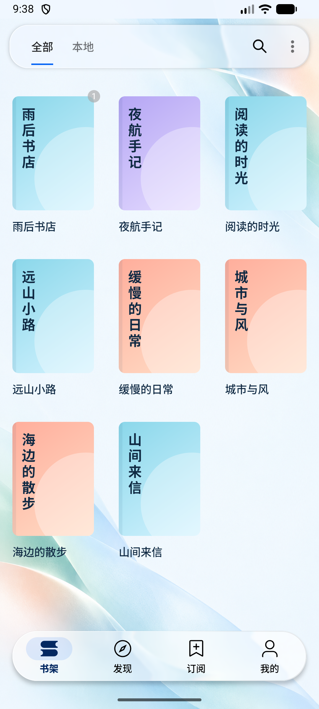

# 默认艺术背景

日期：2026-10-23。使用内置 imagegen 生成一张竖版原图，并原样复制进项目，没有二次改色或合成。

- 文件：`app/src/main/res/drawable-nodpi/background_modern_art.png`。
- 风格：冰蓝白留白、薄荷色半透明曲面、少量浅珊瑚光泽；无文字、标识或水印。
- 接入：浅色「现代·晴空」没有自定义背景图时默认使用；沿用现有背景解码与玻璃取样链路。自选图片和其他配色继续优先，夜间保留深色表面，阅读正文保持独立的阅读配置。
- 原图尺寸：841×1870，PNG，约 1.5 MB。放在 drawable-nodpi 中避免随资源密度放大解码。

## 生成提示词

```text
Use case: abstract-art background. Create ONE refined minimalist contemporary abstract art wallpaper for a native Android ebook library app, portrait 9:20 composition, ideally 1080x2400 or similar high resolution. It is an actual background artwork, NOT an app mockup: no UI, no phone, no books, no lettering, no logos, no watermark. A luminous near-white ice-blue field (#F0F7FF) with enormous clean negative space across the central 75% for dark book titles and colorful covers. At the far upper right and lower left edges, a few large soft sculptural translucent curved planes, like finely frosted folded glass or flowing silk, delicately catching daylight. Restrained fresh sky blue and seafoam mint gradients, with a very small pale apricot/coral glint at one outer edge. Asymmetric editorial gallery aesthetic, elegant and airy, pleasing modern abstract art, gentle dimensional light, meticulously smooth gradients, extremely subtle fine texture. Keep all shapes pale, low contrast, large and softly blended, only peripheral accents slightly richer. The entire central area must remain nearly white with no busy detail so app text stays readable. Edge-to-edge flat artwork, no border, no vignetting or dark areas.
```

## 验证与预览

- `:app:assembleAppDebug` 编译成功；`git diff --check` 通过。
- 已安装最终 APK 并在 Android 17 / API 37 模拟器打开实际书架，确认艺术背景、书名和彩色书封正常显示，顶底栏继续取样背景；运行日志未发现崩溃或着色器回退。
- APK：`app/build/outputs/apk/app/debug/legado_app_3.26.102309.apk`。


