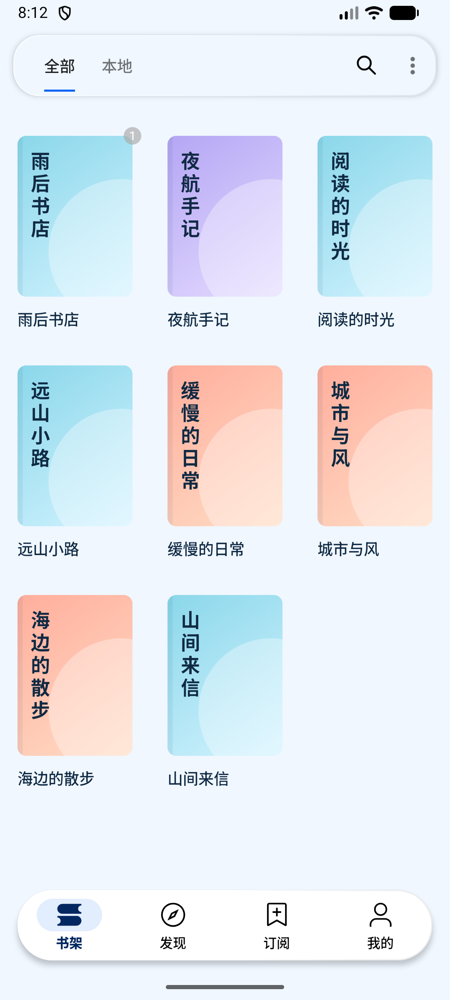
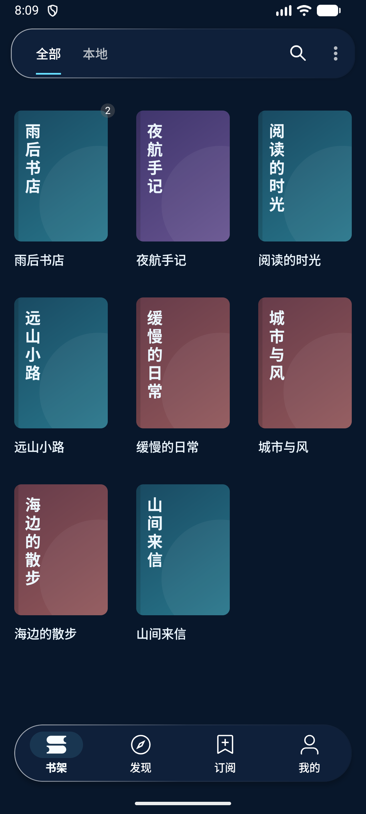
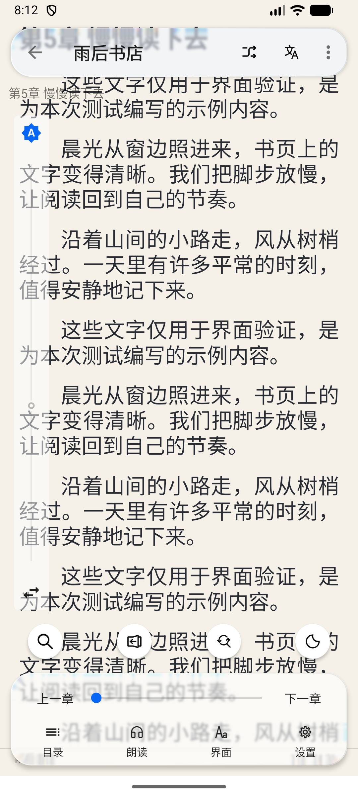
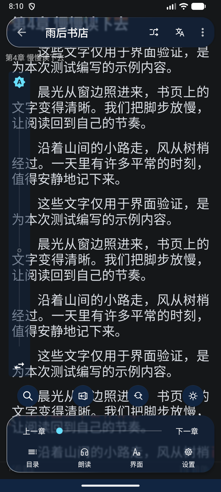

# Liquid Glass 折射、色散与鲜活配色

日期：2026-10-23。本轮接续首轮界面改造，启用实时背景折射与 RGB 色散，并替换偏灰的默认视觉配色。

## 光学材质

- Android 13 / API 33+ 默认启用 AGSL 镜头：圆角距离场决定边缘法线与位移，红、绿、蓝通道分别取样下方内容，形成真实的背景弯折和色散。
- 顶栏、首页底栏和阅读菜单使用同一材质。文字、图标、按钮单独绘制，保持清晰；不对整个控件树应用变形滤镜。
- `GlassBackdropTarget` 共享 GPU RenderNode 内容快照，避免 CPU 截屏和反射访问第三方私有字段。镜头根据屏幕位置更新，与移动、滚动的背景对齐。
- 光学层使用较小的 2dp 模糊，保留背景形状；默认染色约 60.5%，自定义主题按最差背景对比度提高染色浓度。导航文字按相同范围调整前景色。
- 「主题设置 → 玻璃效果强度」同时调节镜头深度、色散幅度和染色，默认 70。开关默认开启。
- Android 12 / API 31–32 使用硬件模糊。更旧系统、墨水屏、省电模式和主动关闭效果时使用实体表面；不支持 AGSL 的驱动保留模糊回退。

镜头采用适合 Android Views 的几何光学近似，折射与色散由下方实际内容取样产生。

## 新默认配色

| 用途 | 现代·晴空 | 现代·星光 |
| --- | --- | --- |
| 页面背景 | `#F0F7FF` 冰蓝白 | `#08172B` 深海蓝 |
| 强调色 | `#0866F5` 鲜蓝 | `#67DFFF` 明青 |
| 导航底色 | `#FFFFFF` | `#112541` |
| 主文字 | `#102A43` | `#EDF7FF` |
| 次级文字 | `#526B83` | `#A9C3DC` |

内置默认书封按书名稳定分配晴蓝、薄荷、珊瑚、鸢尾紫、杏黄和湖蓝色系，加入轻量弧形与书脊细节；夜间使用相应深色版本。真实封面、用户指定的默认封面及已保存的自定义主题继续优先使用。已有安装可在「主题设置 → 主题列表」选择新预设。

## 验证

环境：Android 17 / API 37 模拟器，1080×2400、420dpi；应用使用原生 Android Views，编译 SDK 36、JDK 17。

- `GlassEffectPolicyTest`：3 项通过，覆盖 API 边界、关闭、墨水屏及省电条件。
- `GlassLensShaderTest`：2 项设备测试通过。使用真正的 HardwareRenderer 管线渲染灰度条纹，边缘采样中 189 个像素发生明显位移、168 个出现通道分离；镜头中心保持一致。另覆盖光学背景不得撑大 `wrap_content` 顶底栏的布局回归。
- `ModernBookCoverDrawableTest`：1 项设备测试通过，覆盖重复绘制时书封颜色与不透明度保持稳定；修复了装饰 Paint 透明度残留导致滚动后封面变淡的问题。
- `:app:assembleAppDebug` 成功，最终 APK 已重新安装并运行；检查 `AndroidRuntime` 与 `LiquidGlass` 日志，未发现崩溃或着色器回退记录。XML / JSON 可解析，`git diff --check` 通过。
- APK：`app/build/outputs/apk/app/debug/legado_app_3.26.102308.apk`，约 31 MiB。
- 最终 Lint 仍报告 14 项原有错误，与原始源码按错误 ID、说明和位置比较，新增错误为 0；完整 Lint 任务因此仍失败。

可复现命令（JDK 17）：

```sh
./gradlew :app:assembleAppDebug
./gradlew :app:testAppDebugUnitTest --tests io.legado.app.GlassEffectPolicyTest
./gradlew :app:connectedAppDebugAndroidTest -Pandroid.testInstrumentationRunnerArguments.class=io.legado.app.GlassLensShaderTest,io.legado.app.ModernBookCoverDrawableTest
./gradlew :app:lintAppDebug
```

底层 API 参考：[Android AGSL 使用指南](https://developer.android.com/develop/ui/views/graphics/agsl/using-agsl)、[RenderEffect API](https://developer.android.com/reference/android/graphics/RenderEffect)、[BlurView 3.2.0](https://github.com/Dimezis/BlurView/tree/version-3.2.0)。

## 截图与限制

以下截图均来自模拟器实际运行，并已打开检查。两种主题、三列网格、列表滚动、书封重绘和阅读菜单均已检查；玻璃开关关闭与开启状态分别为 false、true。开启光学效果时，点击下一章后从第 4 章切换至第 5 章。

| 晴空书架 | 星光书架 |
| --- | --- |
|  |  |

| 阅读菜单 | 夜间阅读菜单 |
| --- | --- |
|  |  |

[列表透镜取样](screenshots/optics-bookshelf-refracted-middle.png)、[效果设置](screenshots/optics-settings.png)。

一次混合页面操作与滚动的模拟器观察记录为 434 帧、P50 17ms、P95 34ms、Janky 8.99%；这不是隔离变量的性能基准，也不代表真实设备表现。旧系统兼容性由代码分支与支持条件测试覆盖，尚未在 API 21/30/31/32 设备逐一运行；真实设备的帧时和耗电仍需实机验证。
