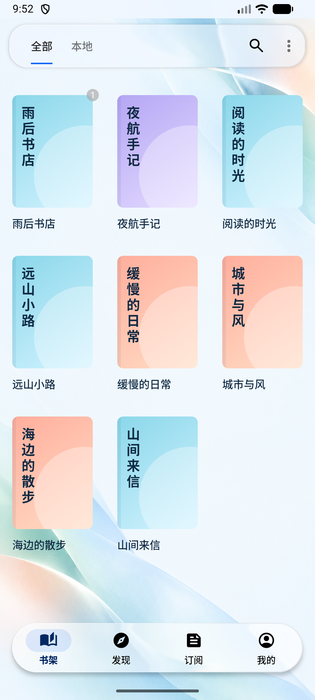
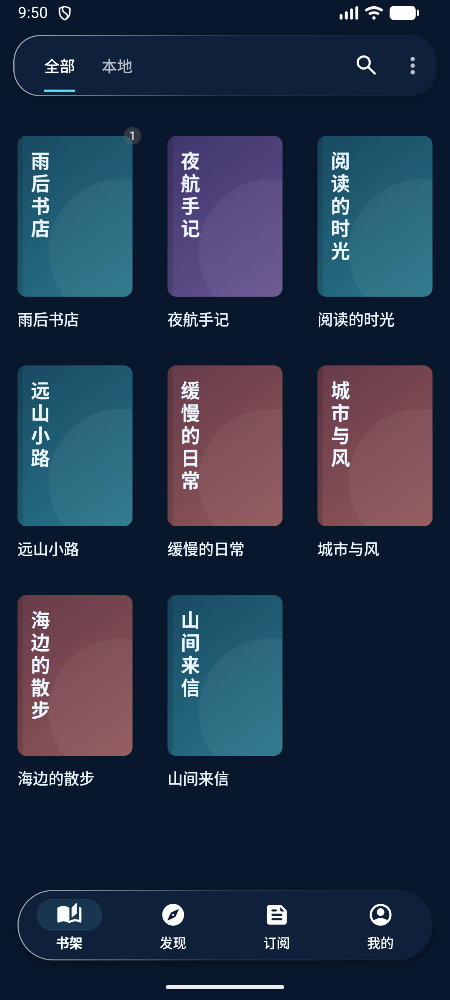
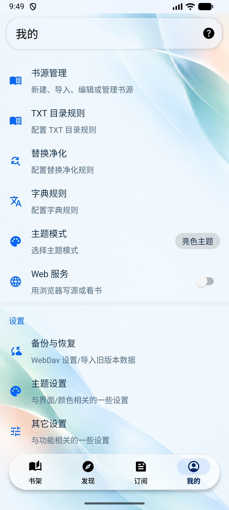
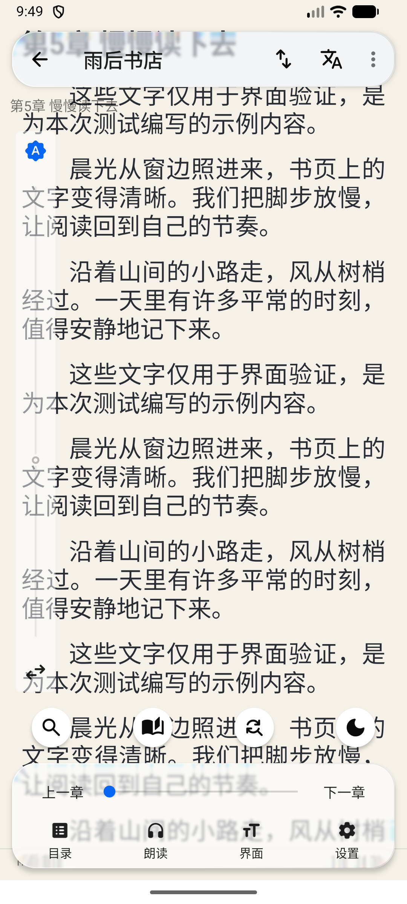

# 现代实心图标

日期：2026-10-23。

界面操作图标统一为 Google Material Symbols Rounded，使用 24px 光学尺寸、400 字重和 FILL=1 实心款式。全部为应用内 Android VectorDrawable，不加载远程字体或引入图标运行库。

## 覆盖范围

共替换 114 个矢量资源，覆盖底部四个入口及其选中状态、顶栏操作、设置入口、阅读菜单、文件/书源管理、备份导入导出、播放、亮度及常用操作。底栏两种状态都使用实心形状，由选中底板和颜色区分状态。

保留原资源 ID、图标容器尺寸和主题 tint；返回箭头支持 RTL 镜像。收藏星标保留未收藏与已收藏的形态差别。桌面品牌图标属于独立的启动器资源。

## 来源与许可

- [Google 官方图标库](https://github.com/google/material-design-icons)，版本 `49d4db35df873165d6bd6ba09b063c7dafbac2f4`。
- [逐项映射与版本记录](modern-icons.json)。
- 许可随 APK 打包于 `app/src/main/assets/licenses/material-symbols.txt`，Apache-2.0。
- SVG 依据各自 viewBox 转换坐标，兼容官方 960 单位与 24 单位两类源文件。

## 验证

114 个 VectorDrawable 均可解析，底栏选中与未选中资源使用相同实心路径，`git diff --check` 通过。

- `:app:assembleAppDebug` 成功，APK 已安装并运行。
- `:app:lintAppDebug`：与原始项目同为 14 项错误，按错误 ID、说明与源码位置对比，新增为 0；完整 Lint 任务仍因原有错误失败。
- 修复了官方 SVG 紧凑连续小数在旧 Android 路径解析器中的兼容问题，使用带前导零、空格分隔的明确数值。
- 已在 Android 17 / API 37 模拟器检查浅色书架、我的页面、阅读菜单和深色书架，并验证页面切换及图标主题着色。未逐项触发全部 114 个资源对应的业务操作，也未在旧系统和 RTL 设备逐一运行。
- 本轮为矢量资源和返回箭头主题配置调整，未增加镜像实现的单元测试。
- APK：`app/build/outputs/apk/app/debug/legado_app_3.26.102309.apk`。

| 浅色书架 | 深色书架 |
| --- | --- |
|  |  |

| 设置入口 | 阅读菜单 |
| --- | --- |
|  |  |

