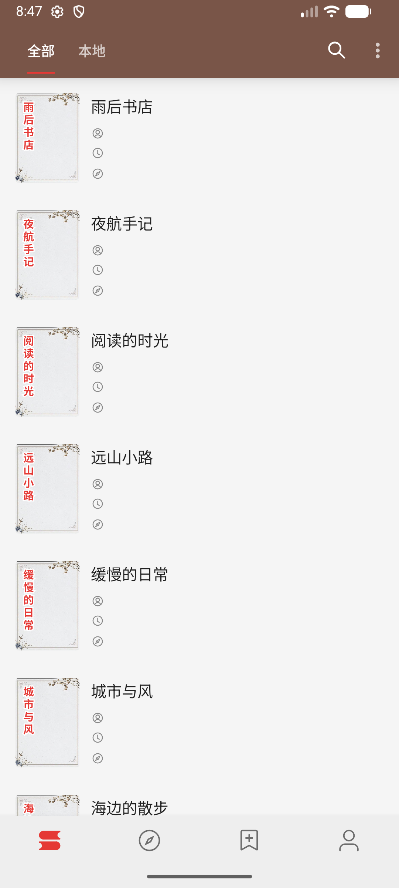
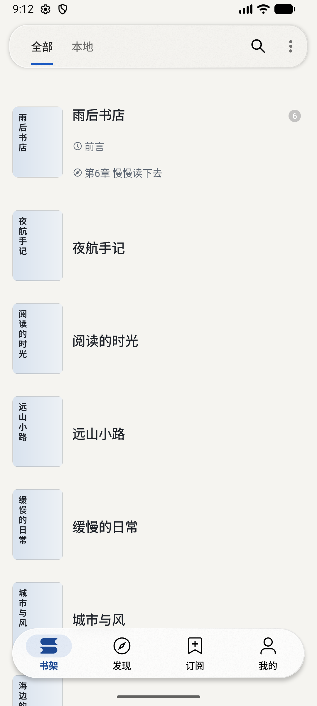
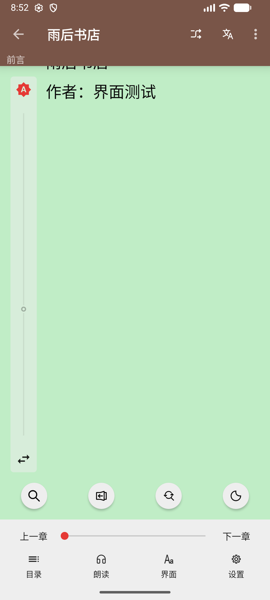
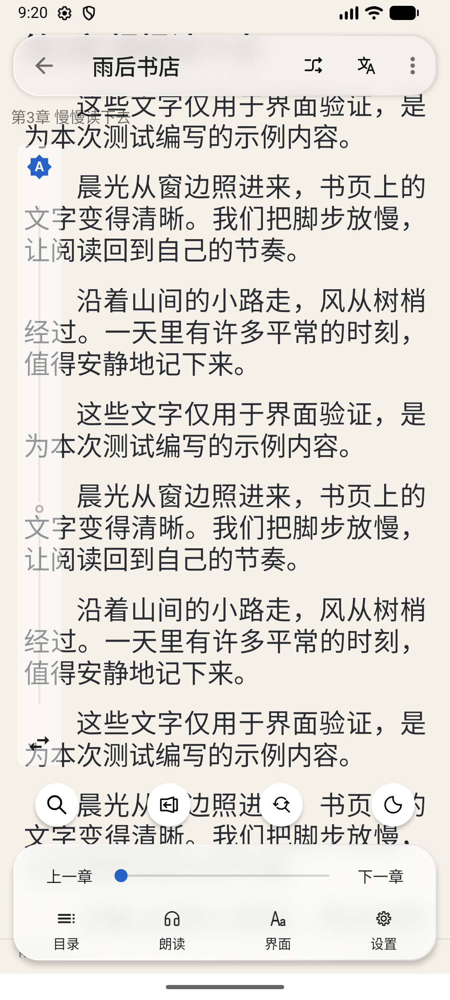
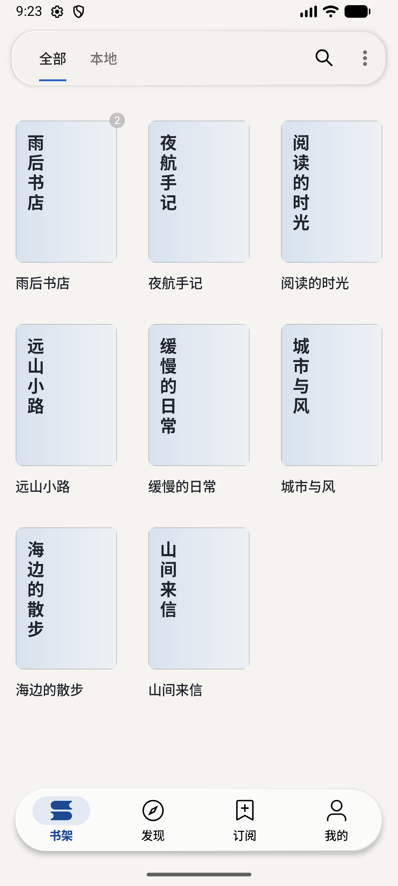
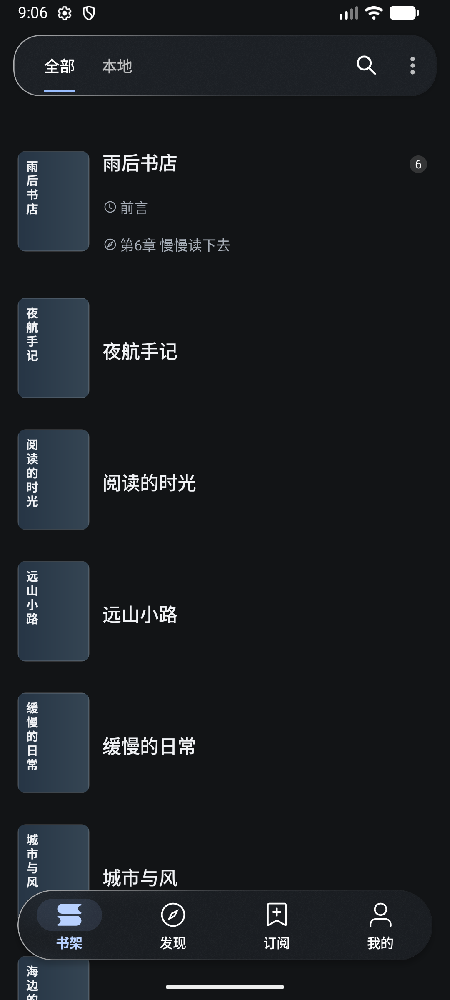
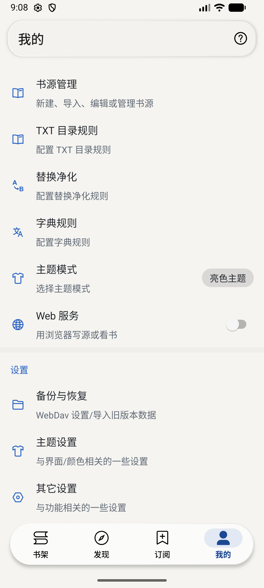
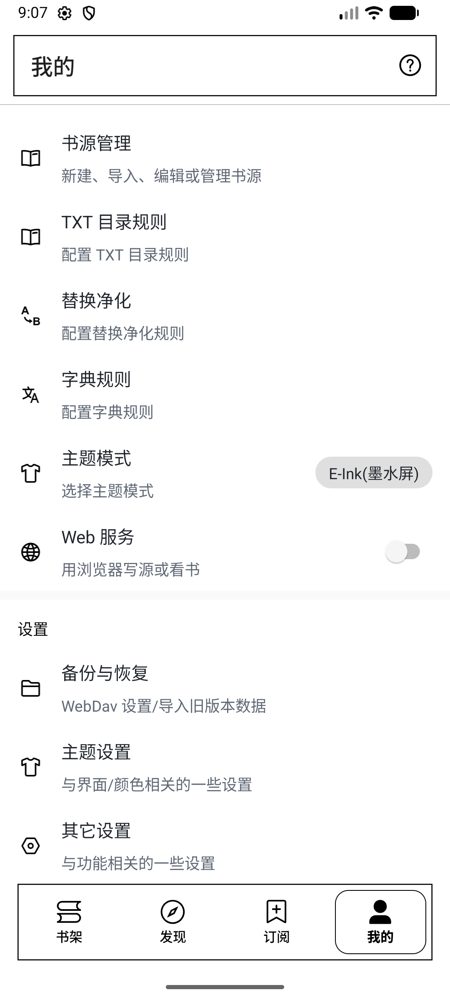

# 现代化界面首轮实施与验证

> 首轮历史记录。2026-10-23 已继续启用折射、色散并更新配色，当前实现见 [光学材质与配色验证](liquid-glass-optics.md)。

日期：2026-10-22。原始源码基线：`aa8819f38`。本轮交付为原生 Android 界面改造及可安装的 debug APK。

## 已完成的界面改造

- 默认配色统一为暖白、石墨灰和蓝色强调色，覆盖资源、运行时 fallback、主题设置默认值、主题保存及内置预设。
- 新增「现代·暖白」「现代·夜读」预设；已有主题列表可以看到新预设，已保存或导入的同名配置不会被覆盖。
- 默认阅读配色改为纸白 `#F5F1E8` / 深色文字 `#292D33`，夜间为 `#151719` / `#D6DAE0`。已有阅读排版文件继续优先使用。
- 首页底栏改为有文字标签、选中底板和角标的悬浮胶囊；原来的菜单 ID、隐藏入口和滑动同步逻辑保留。
- 两种书架、发现、订阅和我的页面接入共享玻璃顶栏及内容避让。设置页的嵌套 PreferenceFragment 使用独立的稳定可视区域。
- 阅读菜单接入相同的玻璃表面，上一章、下一章和进度滑杆容器扩展到 48dp，并补充阅读进度标签。
- 默认占位封面改为简洁底色与清晰文字；真实封面及用户选择的默认封面继续保留。修正 App 手动夜间模式与系统模式不一致时的默认封面取色。
- 书架网格书名改为 14sp、左对齐；列表书名改为 17sp，空作者、阅读记录、最新章节的图标与文字行一并收起。

## 玻璃效果的实现边界

使用固定版本 `com.github.Dimezis:BlurView:version-3.2.0`，将内容取样与控件层分开。当前实现包含动态背景模糊、染色、渐变边缘、圆角、轻投影和原生导航选中反馈，文字和图标保持清晰。

Android 12 / API 31 以下、墨水屏、系统省电模式或用户关闭效果时使用实体材质。墨水屏的选中导航项使用黑色边框；页面未激活、窗口不可见或阅读菜单关闭时停止相应模糊更新。导航前景色按玻璃染色可能允许的背景亮度范围调整，避免只按一张静态背景设置文字颜色。

「主题设置」中提供玻璃开关和染色强度。此版本没有启用 AGSL 折射、色散或液态形变，也不等同于 Apple 系统提供的完整光学材质。

## 本次实际验证

环境：JDK 17、Gradle Wrapper 8.13、Android SDK 36；`Medium_Phone` 模拟器，Android 17 / API 37，1080×2400、420dpi、简体中文。书架使用本次编写并通过文件选择器导入的 8 本原创示例 TXT；不依赖外部书源。

| 步骤 | 检查内容 | 结果与证据 |
| --- | --- | --- |
| 1 | 原始版本启动、空态及有内容书架 | 已构建并截图，作为当前源码的可复现基线 |
| 2 | 改造后列表、三列网格与页面切换 | 已运行并截图；示例书籍和角标保留 |
| 3 | 列表末项与顶底栏避让 | 最后一本封面底部约 2072px，底栏从约 2136px 开始，可完整移至底栏上方 |
| 4 | 深浅色切换、夜间占位封面 | 已运行并截图；夜间封面背景与文字模式一致 |
| 5 | 我的页面及主题设置 | 首个设置条目位于顶栏下方；玻璃开关关闭、开启后的 checked 状态分别为 false、true |
| 6 | 墨水屏模式 | 已在模拟器切换并截图，实体面和选中边框可见；不代表真实电子纸设备性能验收 |
| 7 | 200% 系统字体 | 已截图检查主要书架布局，无观察到的控件遮挡；导航标签仍遵循 Material 组件自身的字体行为；测试后已恢复原系统字体值 1.0 |
| 8 | 本地书籍阅读及菜单 | 纸白阅读背景、顶栏和底部菜单可见；验证进度条标签为「阅读进度」，点击下一章后从第 3 章切换至第 4 章 |

本轮尚未完成所有主题组合、RTL、完整 TalkBack 流程、入口隐藏组合、实际 API 21/30/31 设备以及真实设备帧时和耗电测试；不据模拟器截图推断这些项目已通过。

## 构建、测试与静态检查

```sh
./gradlew :app:assembleAppDebug
./gradlew :app:testAppDebugUnitTest --tests io.legado.app.GlassEffectPolicyTest
./gradlew :app:lintAppDebug
```

- 原始版本、改造版本均成功生成 APK；构建所需 JDK 17 和 SDK 组件已在本次环境中补齐。
- `GlassEffectPolicyTest`：2 项测试通过，覆盖 API 边界、用户关闭、墨水屏与省电模式。
- Lint：原始版本 14 项错误，改造版本同样 14 项错误，对比错误 ID、说明与源码位置后，新增错误为 0。完整 Lint 任务仍失败，不能称为全绿。
- 新增警告主要是旧默认配色资源不再使用、KTX 简化建议；原有错误包括 manifest 类引用、旧 API 用法及缺失翻译，本轮未扩大修改范围去修复。
- 修改过的 XML、JSON 可解析，`git diff --check` 通过；运行时检查未发现 `AndroidRuntime` 崩溃日志。

## 截图

以下为模拟器实际运行截图，均已打开检查；没有使用生成图代替界面证据。对比用于观察配色与控件布局，阅读位置和进度随验证步骤变化。

| 原始界面 | 改造后 |
| --- | --- |
|  |  |
|  |  |

| 三列网格 | 夜间书架 |
| --- | --- |
|  |  |

| 设置页 | 墨水屏模式 |
| --- | --- |
|  |  |

更多验证截图：[末项可达](screenshots/after-bookshelf-scrolled.png)、[夜间设置](screenshots/after-my-dark.png)、[200% 字体](screenshots/after-font-200.png)、[玻璃设置](screenshots/after-glass-settings.png)、[切换章节](screenshots/after-reader-chapter.png)。

## 后续阶段

接下来先在实际 Android 设备采集滚动帧时与阅读耗电，并补齐旧版本和无障碍验证；据结果决定是否加入局部 AGSL 折射增强。搜索、详情、设置的信息结构重组及继续阅读区域属于后续页面迭代，本轮已共享新的基础配色和顶栏样式。
