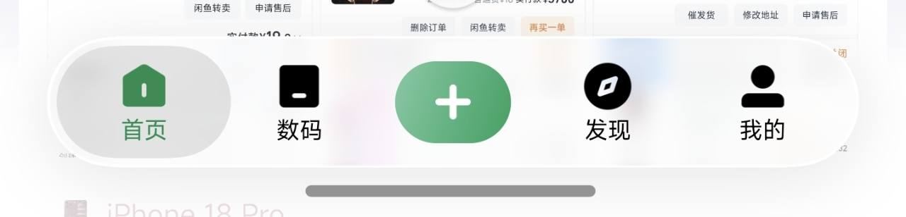

# 底栏视觉对照审阅

日期：2026-10-23。对象为当前 Android 主界面四项底栏，对照用户提供的其他 App 截图。以下实际页面均在本轮重新截图并打开检查。

## 结论

主要问题是导航项内部的组合关系：当前使用 Material 的“仅图标选中底板”，外面再包裹悬浮胶囊；图标和文字没有形成一个完整的选中单元。前面的实现没有把这两层统一起来。

## 步骤 1：书架选中态

状态：切换与标签正常，视觉组合需要调整。

- 当前选中底板是 60×30dp，底栏最小高度 64dp，底板只围住图标，标签位于底板外。
- 参考中的选中底板几乎贯穿底栏内侧高度，同时围住图标和文字，选中状态表达的是整个入口。
- 当前选中色在玻璃最差背景对比度校正后趋向深蓝，和黑色未选中项之间的差别偏弱。完整选中底板可以建立更稳定的局部背景，再据此选择可读的主题色。

## 步骤 2：我的选中态

状态：切换正常，图标轮廓的层级偏多。

- “我的”使用自带圆框的 account_circle，在外层胶囊和选中小胶囊内又叠加圆形轮廓。
- 参考使用人像剪影，和圆形指南针、方形入口产生更清楚的形状区分。建议改用无外圈的实心人像，并检查四个符号的视觉重量。

## 两页共有的材质问题

- 当前下沿暗影较集中，使白色底栏显得厚、有明显托盘感。参考的阴影更分散，边缘更轻。
- 当前小选中底板、粗实心符号与较重底座同时抢注意力，整项选中态反而不够清楚。
- 参考中间的加号是独立主操作，另有其任务语义；本次应先把四个导航项本身的比例与状态统一。

## 建议调整顺序

1. 关闭仅图标的 Material 选中底板，用覆盖“图标＋文字”的整项胶囊。外壳约 64–68dp，内侧选中胶囊约 56–60dp，上下留 4dp 左右，以实际字号适配为准。
2. 图标与标签作为一个居中组合；选中态统一用可读的主题色，未选中态降低一些视觉重量。底板以中性磨砂色为起点。
3. “我的”改用实心人像剪影，对各图标做视觉尺寸校正，而不只设置同一个数值尺寸。
4. 减弱集中在底边的投影，统一描边、染色和折射的存在感，使底栏更轻。

## 实现依据与限制

- `ThemeBottomNavigationVIew.kt`：active indicator 60×30dp、15dp 圆角，框架标签位于其外；两种状态使用同一实心图标。
- `activity_main.xml`：图标 24dp、上下 padding 各 8dp，标签样式为 12sp。
- `GlassSurfaceView.kt`：3dp elevation，1dp 渐变边缘。
- 两张实际截图来自同一 Android 17 / API 37 模拟器。参考图为不同设备、不同裁剪，不能直接比较绝对像素大小。
- 本轮确认了两项点击切换；未据静态参考图判断动画质量，也未完成 TalkBack、放大字体和动态背景下的全流程对比度验收。修正时应保留标签和整项选中反馈，并验证放大字体不会被胶囊裁切。
