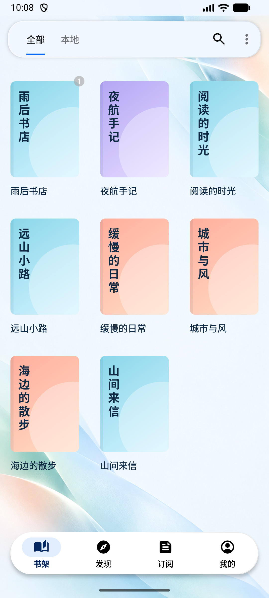
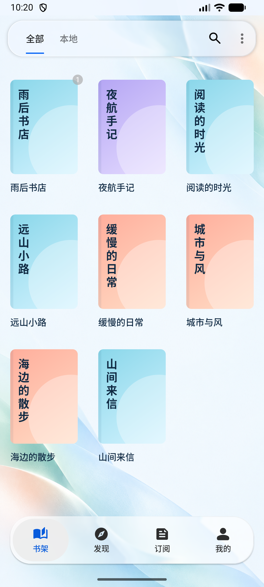
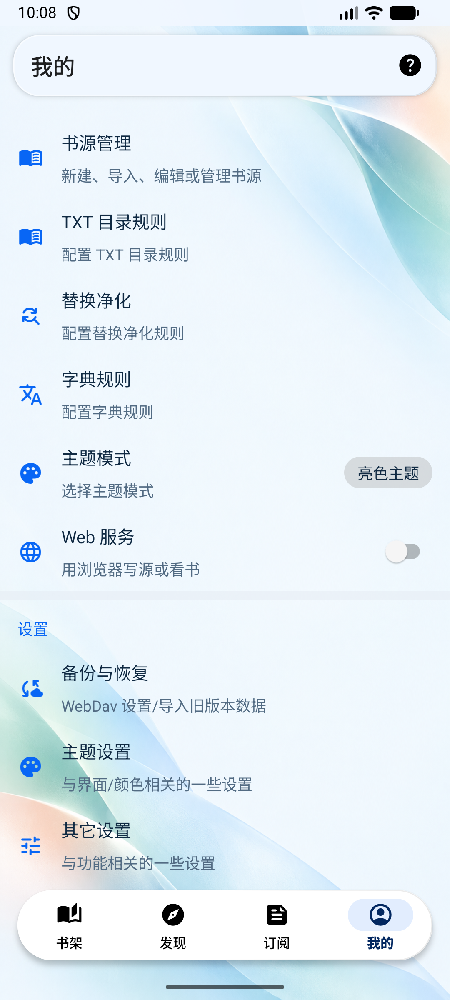
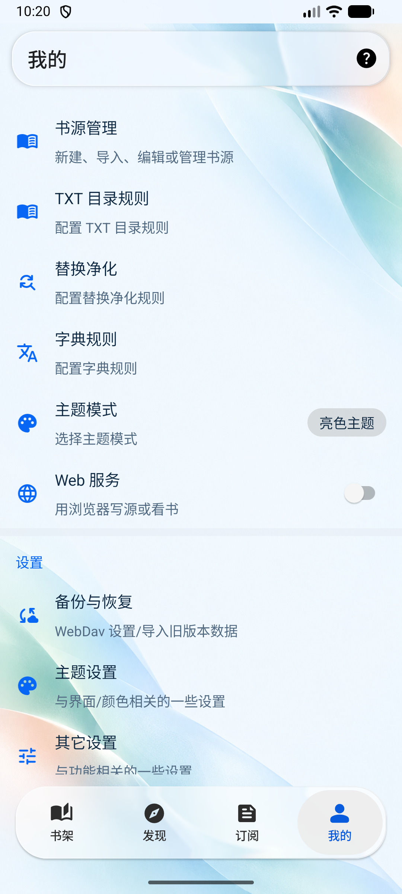
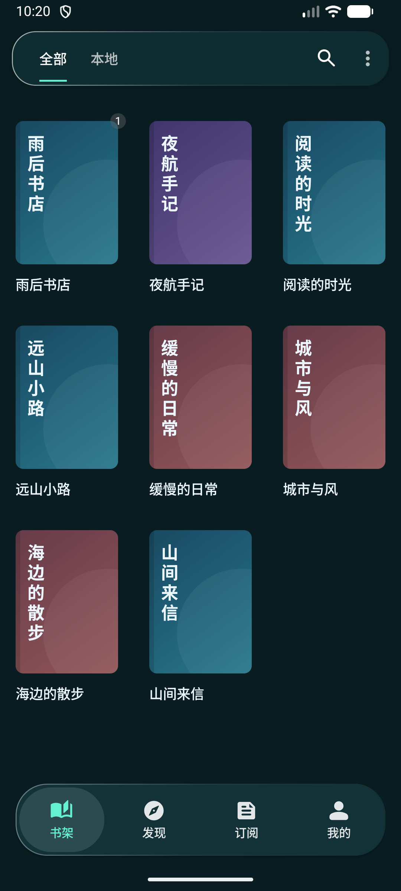
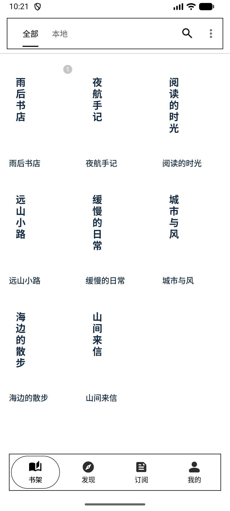
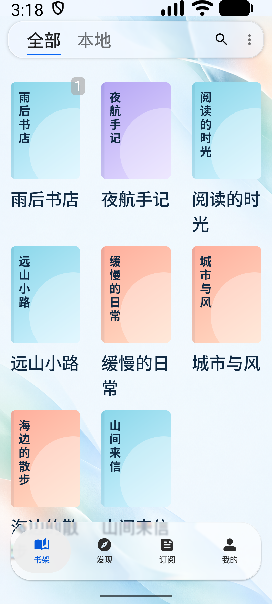

# 底栏整项胶囊优化

日期：2026-10-23。依据用户提供的参考图及[修改前审阅](navbar-audit/findings.md)，调整 Android 主界面底栏。

## 已完成

- 关闭仅包住图标的 Material active indicator，改用覆盖整个导航项的选中胶囊。图标和文字共用底板，四周内缩 4dp，点击反馈也限定在胶囊内。
- 使用中性磨砂选中底色，再依据实际叠加背景校正主题强调色。浅色下的蓝色、深色下的薄荷色更清楚；未选中项保持清晰的中性色。
- “我的”改为无外圈的实心人像，并调整其虚拟画布，使视觉尺寸与其余 24dp 图标协调。资源仍来自现有 Google Material Symbols Rounded，来源见 `modern-icons.json`。
- 底栏投影由 3dp 调整为 1dp，装饰边缘透明度调整为 60%；其他玻璃容器保持原有默认参数，折射和色散继续启用。
- 保留四项入口及现有角标。墨水屏模式使用白底黑色选中边框。

## 前后对比

| 修改前 | 修改后 |
| --- | --- |
|  |  |
|  |  |

## 验证与范围

- Debug APK 构建成功，已安装到 Android 17 / API 37 模拟器。
- `WholeItemNavigationTest` 通过（1 项）：验证选中背景延伸到标签区域，点击“我的”后完整背景随选中项迁移，原选中项背景清除。
- 实际点击书架、发现、订阅、我的四个入口；逐张打开检查亮色、暗色、墨水屏和系统字体 200% 截图。
- 大字体状态下，底栏图标、标签、选中胶囊无裁切；当前 Material 导航标签保持原有字号策略，因此不将此记录视为完整字体缩放或 TalkBack 验收。检查后恢复亮色主题及系统字体 100%。
- Android Lint 仍有项目原有的 14 项错误，与修改前错误集合相比新增 0 项；完整 Lint 任务尚未通过。
- 安装包：`app/build/outputs/apk/app/debug/legado_app_3.26.102315.apk`。

| 暗色 | 墨水屏 | 系统字体 200% |
| --- | --- | --- |
|  |  |  |
