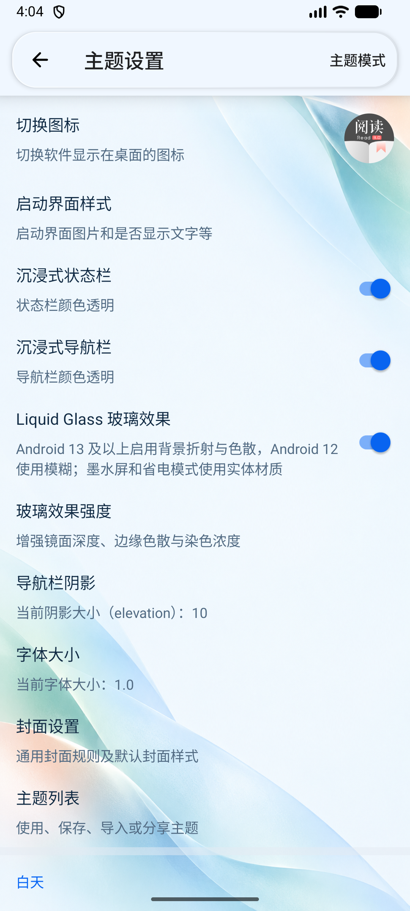
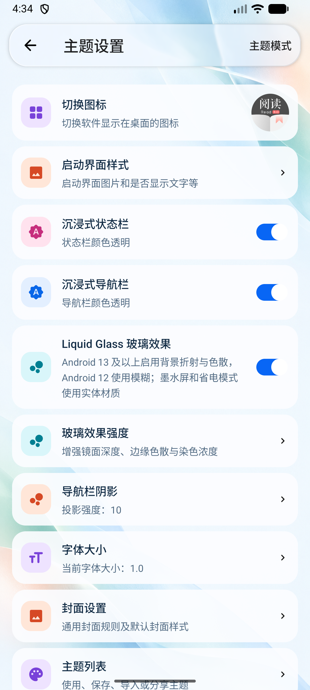
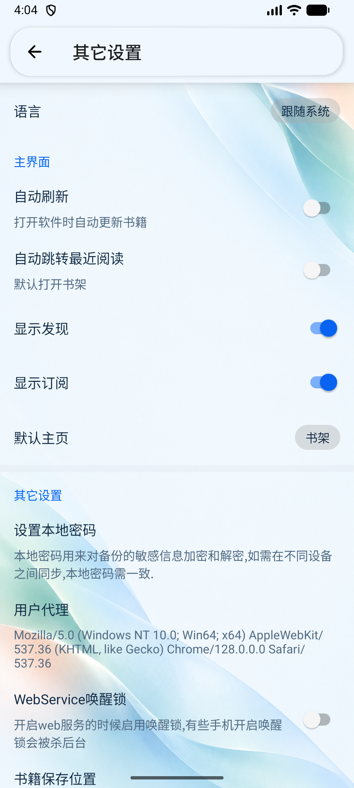
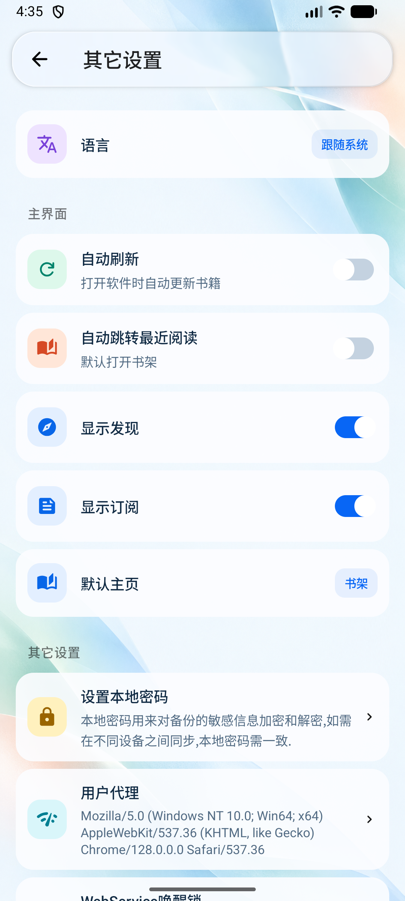
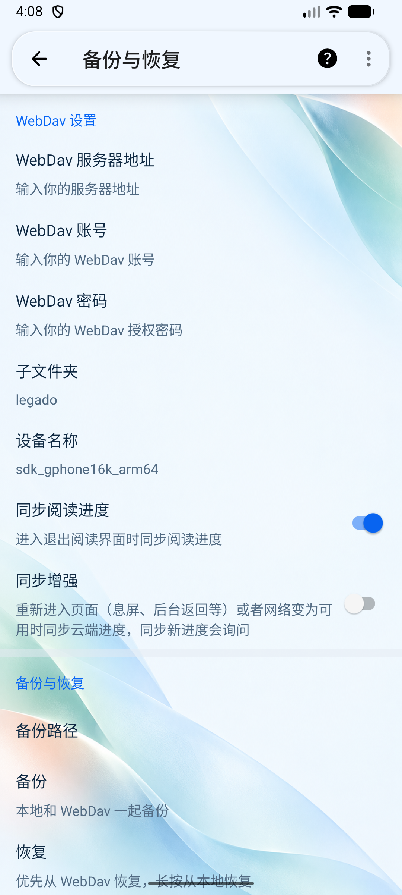
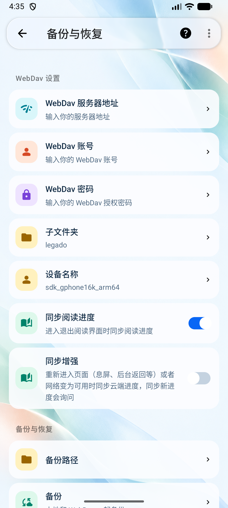
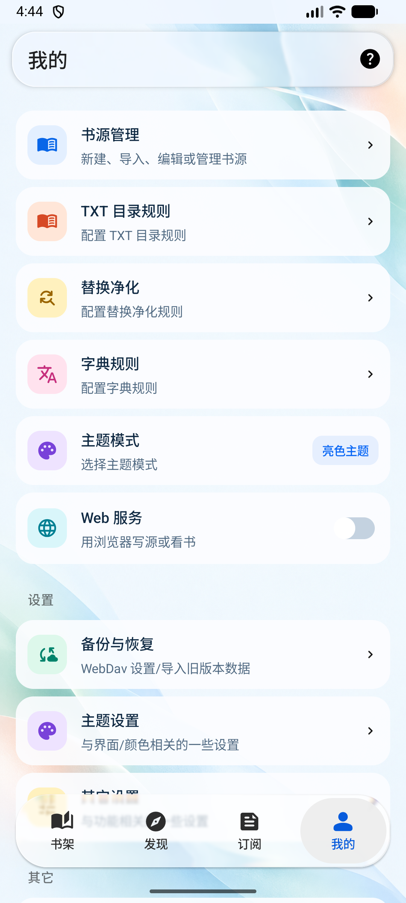
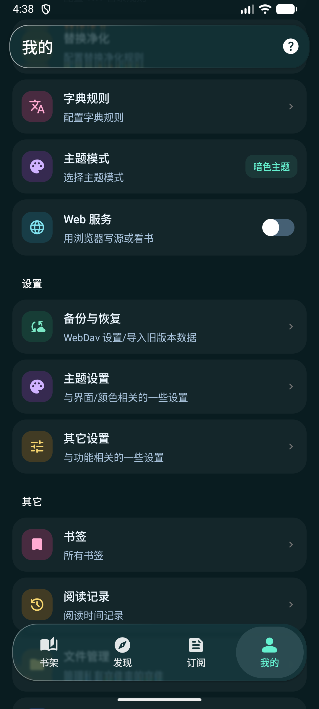
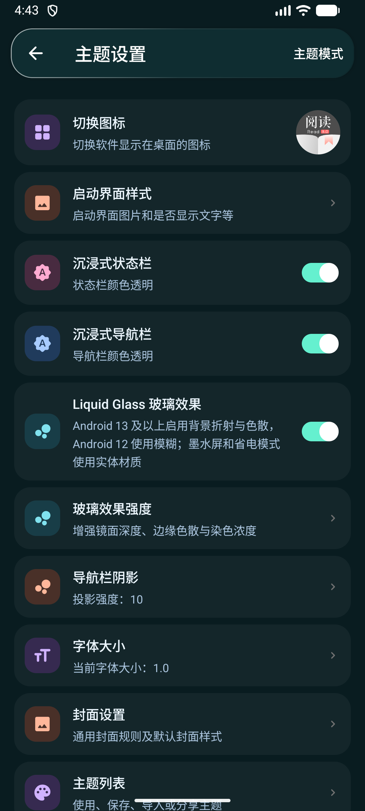
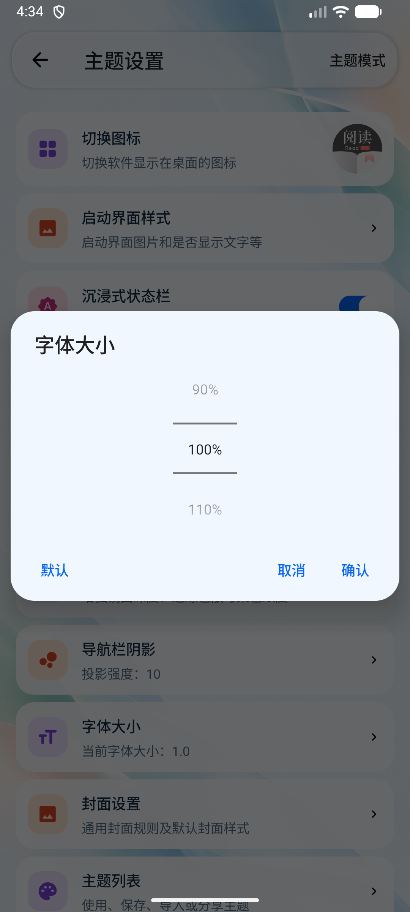

# 设置界面与多彩图标更新

日期：2026-10-23。按当前要求先更新界面、进行视觉确认，不发布安装包，不新增 TDD 测试。

## 本轮发现与处理

1. **设置列表过于平铺。** 主题、其它设置、备份等页面缺少图标与明确的入口层次。统一为有留白的圆角卡片，使用更清楚的标题、说明、分组和进入箭头；长说明保留完整换行。
2. **图标统一蓝色，识别度不足。** 使用蓝、薄荷绿、蜜桃橙、紫、莓粉、明黄、青色七组图标色板。书籍、主题、网络、备份、文件、隐私和日志等入口采用相应的实心图形。深色模式使用独立的亮色图标和深色底片，墨水屏保留黑白回退。
3. **灰色值胶囊与开关显得厚重。** 选项值改为轻量主题色标签，开关更新轨道与滑块比例，保留原生选中、禁用和可访问语义。
4. **通用弹窗接近直角。** 常用输入、选项、数值及内容弹窗统一圆角；溢出菜单也调整圆角。字体和玻璃强度选择显示百分比，字体选择打开时读取当前设置。
5. **子页仍使用实体顶栏底座。** 主题、其它设置、备份、封面、启动界面及关于页接入玻璃取样；首项在静止时位于顶栏下方，滚动时从顶栏后经过。关于页调整介绍区的排版、间距和入口图标。
6. **滚动内容未经过底栏。** 移除“我的”页面宿主容器上的避让内边距，改由列表保留首尾滚动空间。玻璃背景在快照变化时更新，避免静止底栏持续显示旧的空白取样。

## 实际界面对比

| 主题设置：修改前 | 修改后 |
| --- | --- |
|  |  |

| 其它设置：修改前 | 修改后 |
| --- | --- |
|  |  |

| 备份：修改前 | 修改后 |
| --- | --- |
|  |  |

| 我的 | 深色我的 | 深色主题设置 |
| --- | --- | --- |
|  |  |  |

## 验证记录

- 在 Android 17 / API 37 模拟器实际运行，打开并检查浅色设置、备份、封面、关于、字体与输入弹窗、深色设置和滚动状态的截图。
- 字体弹窗当前值显示为 `100%`，取消后原有字号保持不变；WebDav 输入检查未修改已有设置值。
- 已确认滚动内容经过玻璃后方，列表回到顶部时首项完整，末尾功能可以滚到悬浮底栏上方。
- 开发预览构建通过；Android Lint 与原项目同为 14 项错误，新增错误为 0，完整 Lint 尚未通过。
- 本轮不构建或发布新的 Release，也未推送当前设计迭代；模拟器预览使用开发构建。
- 视觉确认不代表已在用户手机上复测，也不等同于完整 TalkBack 或所有系统版本的兼容性验收。
