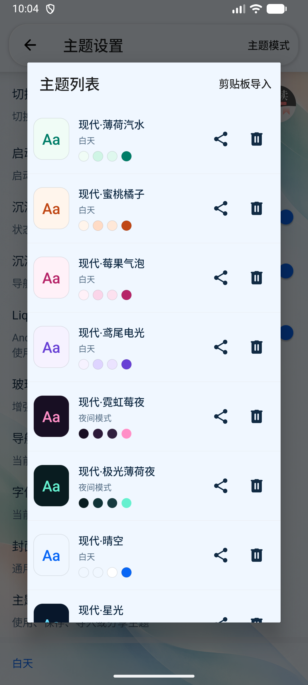
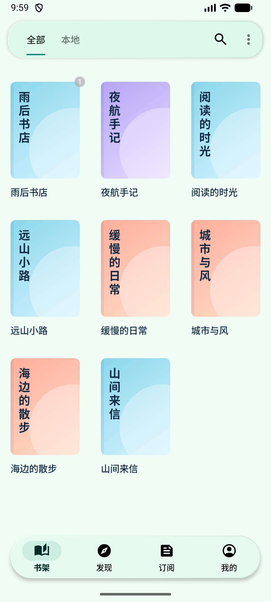
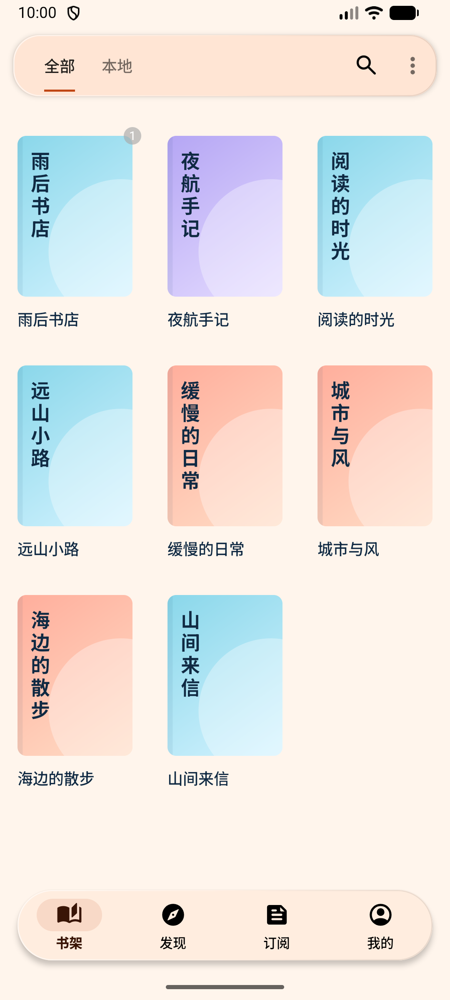
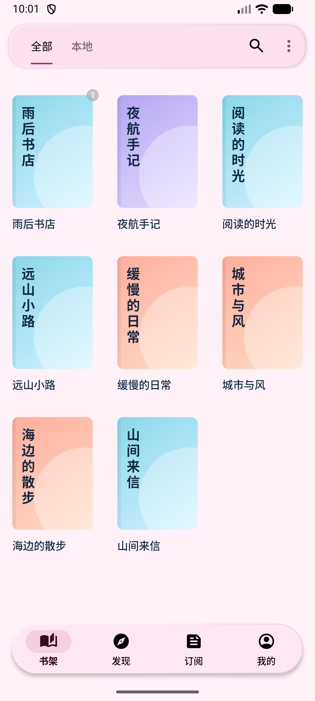
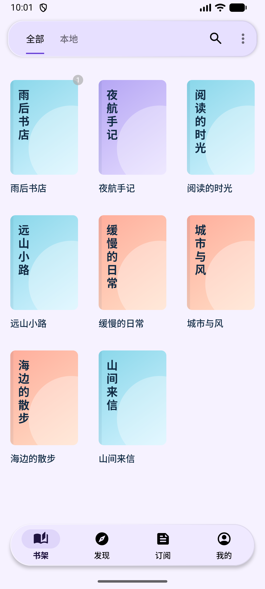
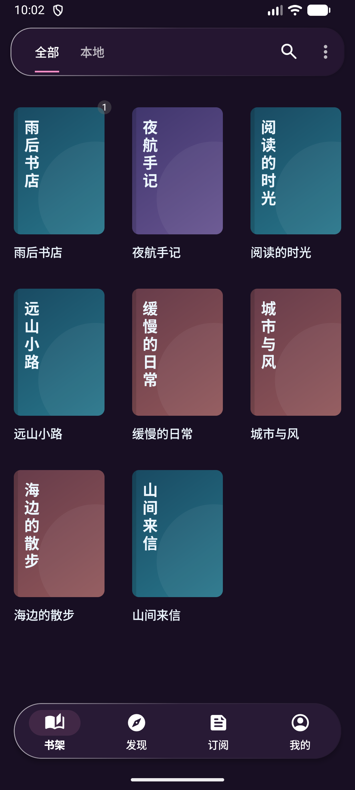
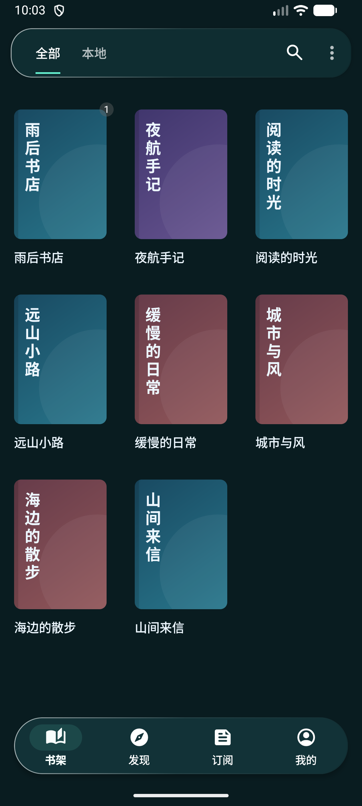

# 六套鲜活配色预设

日期：2026-10-23。入口：我的 → 主题设置 → 主题列表。新增预设会合入已安装应用的列表，保留已保存的主题配置和现有选择。

每套同时搭配页面背景、顶栏、玻璃底栏和强调色。主题列表加入 Aa 预览、日夜标签及四色色板，可以在应用前比较；分享和删除按钮的触摸区域扩展至 48dp。

| 预设 | 气质 | 强调色 | 页面背景 | 顶栏 | 玻璃底色 |
| --- | --- | --- | --- | --- | --- |
| 现代·薄荷汽水 | 清爽、轻盈，推荐日常使用 | `#007D68` | `#F0FCF6` | `#CFF5E5` | `#DFF8EE` |
| 现代·蜜桃橘子 | 明快、温暖，偏活泼 | `#C04715` | `#FFF5EC` | `#FFDBC5` | `#FFE8D8` |
| 现代·莓果气泡 | 甜感、鲜明，玫红强调 | `#B62468` | `#FFF1F8` | `#FAD5E9` | `#FCE1EF` |
| 现代·鸢尾电光 | 清透、轻科技感 | `#6840D5` | `#F6F2FF` | `#DED4FF` | `#EBE3FF` |
| 现代·霓虹莓夜 | 深紫与亮莓粉，夜间更有情绪 | `#FF8FC7` | `#180F23` | `#2C1A39` | `#30203E` |
| 现代·极光薄荷夜 | 深青与荧光薄荷，清晰利落 | `#65F0CF` | `#091C20` | `#103337` | `#163A3F` |

## 验证

六套强调色与页面背景的静态对比度分别为 4.83、4.70、5.58、5.81、8.84、12.45。玻璃导航继续使用原有最差背景范围校正；上述比值不代表每一种半透明叠加状态均具有相同比值。

JSON 名称无重复，颜色格式有效。预览把有效的透明颜色转为不透明色展示，并对无效的旧导入配置提供回退。

## 构建与实际界面

- `:app:assembleAppDebug` 成功，已安装运行；本轮为预设数据和可视化主题列表调整，未增加镜像实现的单元测试。
- 最终 Lint 与原始项目同为 14 项错误，新增为 0；完整任务仍因原有错误失败。
- 六套均已在 Android 17 / API 37 模拟器逐套切换，实际书架截图均已打开检查；检查后恢复原有晴空选择。
- 分享、删除入口保持独立，删除图标改为明确的实心垃圾桶。
- 最终 APK：`app/build/outputs/apk/app/debug/legado_app_3.26.102310.apk`。

| 薄荷汽水 | 蜜桃橘子 |
| --- | --- |
|  |  |

| 莓果气泡 | 鸢尾电光 |
| --- | --- |
|  |  |

| 霓虹莓夜 | 极光薄荷夜 |
| --- | --- |
|  |  |
